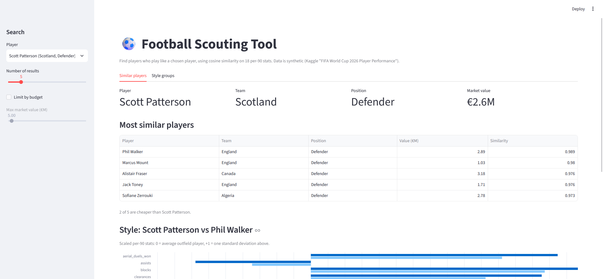
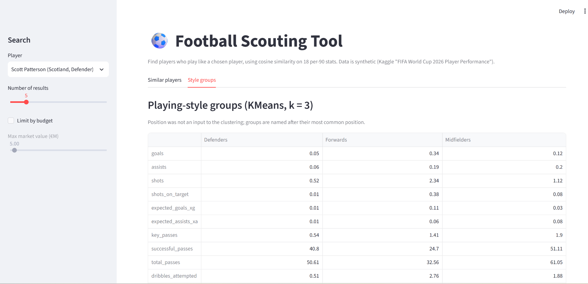

# Football Player Analytics

🔗 **[Live app](https://football-scouting-aziyaa.streamlit.app/)** · Dataset: [FIFA World Cup 2026 Player Performance](https://www.kaggle.com/datasets/rauffauzanrambe/fifa-world-cup-2026-player-performance-dataset) (Kaggle, synthetic)

I built a football player analytics project that answers three questions:

1. **Prediction:** how well will a player perform in their next match?
   → Random forest on past-match features (notebook). MAE 0.507 vs 0.593 for a simple average.
2. **Playing styles:** what types of players exist, based only on what they do on the pitch?
   → KMeans clustering on 18 per-90 stats. Found defenders, midfielders and forwards without being told positions.
3. **Scouting:** which players play like a given player, ideally for less money?
   → Cosine similarity with a budget filter (live app).

First, I removed the 42% of rows where players didn't play (0 minutes, rating 0) and built the analysis on the remaining 31,558 player-match rows.

## Screenshots

| Similar players | Style groups |
|---|---|
|  |  |

## Key results

**1. Next-match rating prediction** (test set = matches from 23 July onwards)

| Model | Test MAE |
|---|---|
| Global mean (same guess for everyone) | 0.593 |
| Average of last 3 matches | 0.578 |
| Career average so far | 0.512 |
| **Random forest** | **0.507** |

The random forest only slightly beats the career-average baseline. Ratings in this data depend mostly on a player's long-term ability (career average and market value make up about 80% of feature importance), and recent form adds little.

**2. Playing-style clustering**
- k = 3 chosen by the elbow method and the best silhouette score (0.41)
- Clusters match positions perfectly (ARI 1.0), even though position was **not** an input
- Forwards: most shots and dribbles · Defenders: most clearances, tackles and interceptions · Midfielders: most passes and key passes

**3. Similar-player finder**
- Across all 1,104 outfield players, 100% of the top-5 matches share the player's position
- Average similarity of the top 5: **0.92**, vs **0.01** for random pairs
- Example: for a €3.8M defender, five near-identical alternatives (similarity ≥ 0.95) cost under €2M

## Approach

- **Data understanding:** checked duplicates, dates and the meaning of zero ratings; removed players who didn't play; excluded whole-tournament columns (e.g. `tournament_rating`) because they contain future information.
- **Prediction:** built "look-back" features per player (previous rating, last-3 average, career average) using only past matches; split train/test **by date** to avoid leakage; compared the random forest against simple baselines.
- **Clustering:** one row per player, stats converted to **per 90 minutes**, standardised, then KMeans. Goalkeepers excluded.
- **Scouting:** cosine similarity on the same standardised per-90 stats, with an optional budget filter, served through a Streamlit app.

## Limitations

- The dataset is **synthetic** (1,050 matches in 51 days), so results describe the simulation, not real players.
- Positions are unusually well separated in this data; real players overlap more (e.g. full-backs vs wingers), so a perfect ARI would be unlikely on real data.
- About 21% of matches share a date with another match by the same player (a simulation artefact).
- No opponent-strength or team-context features.

## Next steps

- Add a next-match forecast tab to the app
- Try gradient boosting and permutation importance for the prediction model
- Gaussian mixture clustering for players who sit between roles

## Project files

| File | Purpose |
|---|---|
| `Football_players_analytics.ipynb` | Full analysis: data checks, prediction, clustering, similarity |
| `app.py` | Streamlit scouting app |
| `players.csv` | Per-player per-90 stats and cluster labels (exported from the notebook) |
| `requirements.txt` | Python libraries |

## Run locally

```bash
pip install -r requirements.txt
streamlit run app.py
```

**Tools:** Python, pandas, scikit-learn, Streamlit